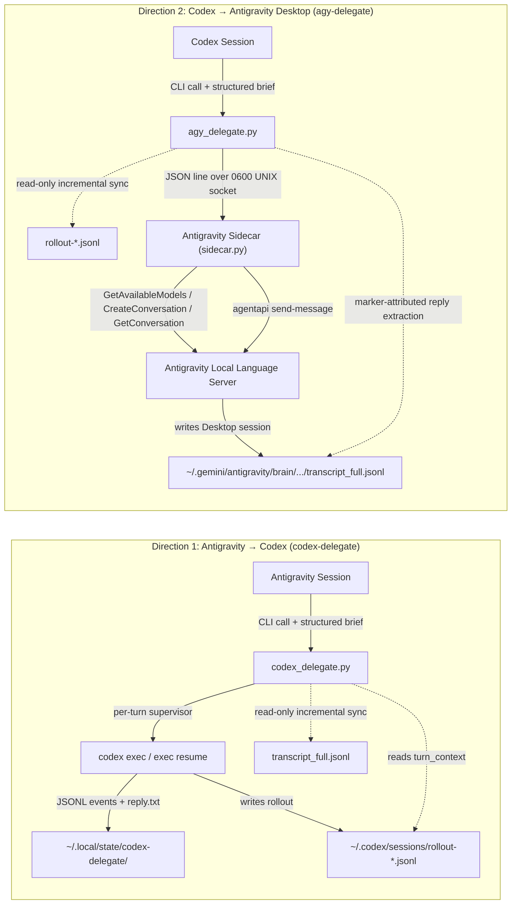
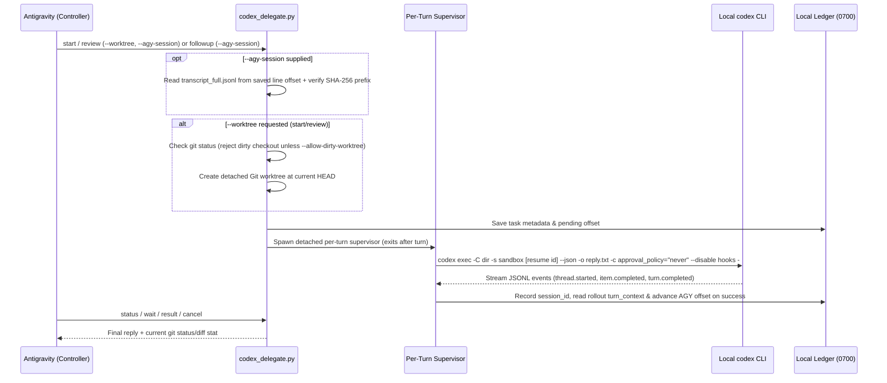

# codex-antigravity-delegate

Supervised, two-way delegation between **OpenAI Codex** and **Google Antigravity**. Two portable agent skills and a lightweight Antigravity Desktop sidecar; Python 3.9+ standard library only.

Hand off implementation, code reviews, or document rewrites without leaving your current window. Follow up in the same session and review the resulting changes before accepting — without copy-pasting transcripts, running a heavy MCP relay, or wrapping `agy -p`.

---

## Why This Exists

Delegation between Codex and Antigravity is asymmetric:

- **Antigravity → Codex**: the local `codex` CLI natively supports non-interactive execution (`codex exec`), session continuation (`codex exec resume`), explicit model and reasoning effort flags, and OS-level sandboxes (`read-only` / `workspace-write`). `codex-delegate` adds optional Git worktree isolation on top.
- **Codex → Antigravity**: wrapping `agy -p` inside third-party coding agents is unsupported under Antigravity consumer plans ([Antigravity FAQ](https://antigravity.google/docs/faq)), while heavy third-party MCP bridges couple tightly to private desktop internals.

This repository matches each direction to the lightest mechanism its target tool supports:

1. **`codex-delegate` (`Antigravity → Codex`)** — A zero-daemon Python wrapper around native `codex exec` / `codex exec resume`, using a per-turn supervisor process that exits as soon as the turn finishes.
2. **`agy-delegate` (`Codex → Antigravity Desktop`)** — A lightweight sidecar built on Antigravity Desktop's Sidecar mechanism (~300 lines of Python stdlib, `0600` local UNIX socket only) that talks to Desktop's local language-server RPCs and `agentapi`, paired with a symmetric CLI skill for interactive reviews, document rewrites, and follow-ups.

All three pieces use **only the Python 3.9+ standard library** — no third-party packages, no TCP listeners, and no private Codex Desktop pipes.

---

## What It Can Do

| Capability | `codex-delegate` (`Antigravity → Codex`) | `agy-delegate` (`Codex → Antigravity Desktop`) |
| --- | --- | --- |
| **Primary use cases** | Implementation, isolated bug fixes, read-only code review, multi-turn rework | Interactive code/design review, document rewriting, Desktop-visible follow-ups |
| **Zero window switching / copy-paste** | Yes | Yes (while Antigravity Desktop is running) |
| **Model & effort selection** | `--model` (defaults to Codex config; full ID or `sol` / `astra`) + `--effort`; no silent fallback | `--model` (default `neon`; full ID or `neon`, `neon-xhigh`, `neon-medium`, `carbon`, `argon`, `flash`); validated against Desktop catalog, no silent fallback |
| **Read-only code review** | OS-enforced `read-only` sandbox (`--uncommitted`, `--base`, `--commit`) | Instruction-scoped review (`--uncommitted`, `--base`, `--commit`, or `--file`) |
| **Isolated Git worktree** | Wrapper-managed `--worktree` with dirty-checkout protection | Not used (shares workspace for reviews & doc edits) |
| **Same-session follow-up** | `followup` via `codex exec resume` (can override model/effort) | `followup` via `agentapi send-message` (keeps original session & model) |
| **Incremental conversation handoff** | `--agy-session <UUID>` with line offset + SHA-256 prefix check | `--codex-session <UUID>` with line offset + SHA-256 prefix check |
| **Background supervision** | `--background`, `status`, `wait` (exit `124` on timeout), `result`, `list` | `--background`, `status`, `wait` (default 300s foreground timeout; exit `124` on timeout), `result`, `list` |
| **Cancellation / `Ctrl+C`** | `cancel` (`SIGTERM` → `SIGKILL` to process group, exit `130`); foreground `Ctrl+C` cancels the run | Manual **Stop** in the Antigravity Desktop conversation; foreground `Ctrl+C` only stops local waiting |
| **Read-only session lookup** | `read-session` for both Codex `rollout-*.jsonl` and AGY `transcript_full.jsonl` | — (use `codex_delegate.py read-session --source agy`) |

---

## Repository Structure

```text
codex-antigravity-delegate/
├── install.sh                               # Idempotent installer & uninstaller
├── skills/
│   ├── codex-delegate/
│   │   ├── SKILL.md                         # Skill instructions for Antigravity → Codex
│   │   └── scripts/codex_delegate.py        # Native Codex CLI supervisor & session reader
│   └── agy-delegate/
│       ├── SKILL.md                         # Skill instructions for Codex → Antigravity Desktop
│       └── scripts/agy_delegate.py          # Sidecar client, ledger & transcript extractor
├── sidecar/
│   └── agy-delegate/
│       ├── sidecar.json                     # Antigravity Sidecar manifest template
│       └── sidecar.py                       # 0600 UNIX-socket bridge to Desktop LS & agentapi
├── tests/
│   ├── test_codex_delegate.py               # Unit & stub integration tests for codex-delegate
│   ├── test_agy_delegate.py                 # Unit & stub integration tests for agy-delegate + Sidecar
│   └── test_install.py                      # Isolated HOME installer/uninstaller tests
└── .github/workflows/test.yml               # CI matrix (Ubuntu & macOS × Python 3.9 / 3.12)
```

---

## Installation

### Prerequisites

- **OS**: **macOS and Linux only** (requires POSIX `fcntl` and `AF_UNIX` sockets; Windows is not supported).
- **Runtime**: **Python 3.9+** and **Git**.
- **For `codex-delegate`**: an authenticated local **Codex CLI**. Discovery order:
  1. `$CODEX_DELEGATE_CODEX`
  2. ChatGPT Desktop embedded CLI on macOS (`/Applications/ChatGPT.app/Contents/Resources/codex-cli/CodexCLI.app/Contents/MacOS/codex`)
  3. `codex` on `PATH`
  4. Newest executable under `~/.nvm/versions/node/*/bin/codex`
- **For `agy-delegate`**: **Antigravity Desktop** installed and running with Sidecars enabled.

> [!IMPORTANT]
> Run `./install.sh` using a **stable system Python** (not inside a temporary virtualenv or ephemeral shim), because the installer writes `sys.executable`'s absolute path into the installed `sidecar.json` so Antigravity Desktop can launch the sidecar under a minimal `PATH`.

### Quick Install

```bash
git clone https://github.com/Al-assad/codex-antigravity-delegate.git
cd codex-antigravity-delegate
./install.sh
```

What `./install.sh` does:
1. Validates every target **before writing anything**; if an unmanaged or locally edited install is found, the installer aborts without modifying any files.
2. Installs [`codex-delegate`](skills/codex-delegate/SKILL.md) and [`agy-delegate`](skills/agy-delegate/SKILL.md) into `${AGENTS_SKILLS_DIR:-$HOME/.agents/skills}/`.
3. Copies the sidecar into `${GEMINI_CONFIG_DIR:-$HOME/.gemini/config}/sidecars/agy-delegate/` and writes the active Python 3 absolute path into the installed `sidecar.json`.
4. Atomically updates `${GEMINI_CONFIG_DIR:-$HOME/.gemini/config}/config.json` to enable `sidecars["agy-delegate"]`, preserving all existing settings, `projectId`, and other sidecars.

### Installer Options

```bash
./install.sh --copy                # Copy skills (default; repo checkout not needed at runtime)
./install.sh --symlink             # Symlink skills to this checkout (Sidecar is still copied)
./install.sh --only codex          # Install only codex-delegate (no Sidecar)
./install.sh --only agy            # Install only agy-delegate + Sidecar
./install.sh --dry-run             # Preview planned changes without writing anything
./install.sh --uninstall           # Remove managed files; remove or disable sidecars["agy-delegate"]
```

### Upgrading & Handling Conflicts

- **Upgrading**: run `git pull && ./install.sh` (even if you used `--symlink` for the skills, re-run `./install.sh` when `sidecar/` changes because the sidecar is always copied).
- **Existing unmanaged installs**: if `./install.sh` reports an unmanaged directory conflict, back it up and move it aside first, then re-run:
  ```bash
  mv ~/.agents/skills/codex-delegate ~/.agents/skills/codex-delegate.bak
  ./install.sh
  ```

### Verify Installation

```bash
SKILLS="${AGENTS_SKILLS_DIR:-$HOME/.agents/skills}"

# 1. Verify Codex CLI availability & codex-delegate wrapper
codex --version
"$SKILLS/codex-delegate/scripts/codex_delegate.py" --help

# 2. Verify agy-delegate Sidecar health (Antigravity Desktop must be running)
"$SKILLS/agy-delegate/scripts/agy_delegate.py" health --json
```

`health --json` prints a compact single-line JSON object; formatted for readability, a healthy response looks like:

```json
{
  "state": "ready",
  "pid": 12345,
  "started_at": "2026-01-01T00:00:00+00:00",
  "agentapi_path": "/Applications/Antigravity.app/Contents/Resources/bin/language_server",
  "has_ls_address": true,
  "has_csrf_token": true,
  "default_project_id": "..."
}
```

### Troubleshooting

| Symptom | Likely Cause & Fix |
| --- | --- |
| `health` says socket missing or connection refused | Antigravity Desktop is not running, or did not hot-load the newly enabled sidecar. Restart **Antigravity Desktop** once and run `health` again. |
| `health` returns `"state": "degraded"` | The sidecar started, but Desktop did not inject `ANTIGRAVITY_LS_ADDRESS` / `ANTIGRAVITY_CSRF_TOKEN` (`has_ls_address` / `has_csrf_token` is `false`), or `agentapi` was not found (`agentapi_path: null`). |
| Permission error requiring mode `0700` | Run `chmod 700 ~/.local/state/codex-delegate ~/.local/state/agy-delegate` and confirm the directories belong to your user. |
| Codex rejects a requested model | Check which Codex binary was discovered (macOS ChatGPT Desktop embedded CLI takes precedence over `PATH`); override with `CODEX_DELEGATE_CODEX` if needed. |

---

## Usage Examples

### Inside Antigravity (`codex-delegate`)

Ask Antigravity directly in natural language:

- **Read-only code review of uncommitted edits:**
  > "Use `codex-delegate` with `gpt-6.2-sol` (high) to run a background read-only review of the uncommitted changes in this repo, focusing on race conditions and edge cases."
- **Isolated implementation in a Git worktree + follow-up:**
  > "Use `codex-delegate` to delegate fixing the pagination boundary to `sol` (high) in a separate `--worktree` and run the unit tests. Show me the resulting changes before I merge."
- **Read-only lookup of a prior Codex thread:**
  > "Use `codex-delegate read-session` to inspect the last 10 messages of `codex://threads/<UUID>`."

Direct CLI equivalents:

```bash
cdg="${AGENTS_SKILLS_DIR:-$HOME/.agents/skills}/codex-delegate/scripts/codex_delegate.py"

# Start an isolated implementation task in the background
"$cdg" start --cwd /path/to/repo --model sol --effort high \
  --worktree --include-git --background --json-output \
  --prompt 'Fix the pagination boundary without changing the public API. Run the unit tests.'

# Review uncommitted changes (read-only sandbox, shared checkout)
"$cdg" review --cwd /path/to/repo --uncommitted --model sol --effort high \
  --prompt 'Check for race conditions and list findings with file and line numbers.' --background

# Supervise, inspect, follow up in the same Codex session, or cancel
"$cdg" status <task-id> --json-output
"$cdg" wait <task-id> --timeout 120 --json-output
"$cdg" result <task-id>
"$cdg" followup <task-id> --prompt 'Add a regression test for empty pages.' --background
"$cdg" cancel <task-id> --grace 3

# Read local Codex or Antigravity session logs without calling any model
"$cdg" read-session 'codex://threads/<UUID>' --tail 8
"$cdg" read-session '<agy-uuid>' --source agy --tail 8
```

> Worktrees live under `~/.local/state/codex-delegate/<task-id>/worktree` and are never merged or deleted automatically. Once you have retrieved any changes you want to keep, remove the worktree with `git -C /path/to/repo worktree remove <worktree-path>`.

### Inside Codex Desktop (`$agy-delegate`)

> [!NOTE]
> Open the target repository as a project in **Antigravity Desktop** first. Otherwise the sidecar falls back to its default project (`project_match: unmatched_default`) and the Desktop agent may not have permission to read your files. Check `project_id` and `project_match` in the response.

Invoke the skill explicitly with `$agy-delegate`:

- **Read-only review by Neon:**
  > "Use `$agy-delegate` to ask `neon` for a read-only review of my uncommitted changes here, focusing on regression risks."
- **Document rewrite by Carbon:**
  > "Use `$agy-delegate` to have `carbon` tighten `docs/architecture.md` while keeping every technical fact and open question intact."
- **Continue the same Desktop conversation:**
  > "Follow up on that `agy-delegate` task and ask it to shorten section 3 by half."

Direct CLI equivalents:

```bash
agy="${AGENTS_SKILLS_DIR:-$HOME/.agents/skills}/agy-delegate/scripts/agy_delegate.py"

# Check sidecar readiness
"$agy" health

# Ask Neon for a read-only review
"$agy" review --cwd /path/to/repo --uncommitted --model neon \
  --prompt 'Focus on regressions and edge cases.' --background

# Ask Carbon to rewrite a specific file
"$agy" doc --cwd /path/to/repo --file docs/plan.md --model carbon \
  --prompt 'Make this concise without changing facts or open questions.' --background

# Wait, inspect reply + git status/diff stat, and follow up in the same Desktop session
"$agy" wait <task-id> --timeout 120
"$agy" result <task-id>
"$agy" followup <task-id> --prompt 'Shorten section 3 and keep the checklist.'
```

---

## How It Works

### High-Level Architecture

Both directions use structured briefs, local ledgers, and checksummed incremental log sync. Each relies on the native mechanism its target tool offers:



### Flow 1: `codex-delegate` (`Antigravity → Codex`)



#### Implementation Notes

- **Review adapter**: Local `codex exec review` does not combine scope flags (`--uncommitted`, `--base`, `--commit`) with custom stdin prompts or `-C`/`-s`, so `codex-delegate` always uses `codex exec -s read-only` with an explicit verified Git scope.
- **Dirty-worktree guard**: A Git worktree created from `HEAD` never includes staged, unstaged, or untracked edits. `codex-delegate` rejects `--worktree` on a dirty checkout unless `--allow-dirty-worktree` is passed, and always forbids `--worktree` for uncommitted reviews.
- **Process-group cancellation**: Each Codex turn runs in its own session (`start_new_session=True`), so `cancel` sends `SIGTERM` (and `SIGKILL` after `--grace`) to the entire process group and reports that file edits are not rolled back.
- **No silent model fallback**: Actual executed model, effort, and working directory are read back from Codex's own `rollout-*.jsonl` `turn_context` records rather than guessed.

### Flow 2: `agy-delegate` (`Codex → Antigravity Desktop`)

```mermaid
sequenceDiagram
    participant CDX as Codex (Controller)
    participant CLI as agy_delegate.py
    participant SC as Sidecar (sidecar.py, 0600 sock)
    participant LS as Antigravity Desktop LS / agentapi
    participant LOG as transcript_full.jsonl

    CDX->>CLI: review / doc / start / followup (--codex-session)
    opt --codex-session supplied
        CLI->>CLI: Read Codex rollout delta from saved line offset + verify SHA-256 prefix
    end
    CLI->>LOG: Snapshot transcript baseline (follow-ups; new conversations start at line 0)
    CLI->>SC: Send JSON request with unique [AGY-DELEGATE:TOKEN] marker
    alt New task
        SC->>LS: GetAvailableModels (reject unlisted models, no fallback)
        SC->>LS: ConversationService/CreateConversation (matched projectId + model + prompt)
    else Follow-up
        SC->>LS: GetConversation (require RUN_STATE_IDLE under per-conversation lock)
        SC->>LS: agentapi send-message CONVERSATION_ID PROMPT
    end
    SC-->>CLI: Confirmed conversation_id & project_match
    loop Until RUN_STATE_IDLE and matched reply appears
        CLI->>SC: status(conversation_id)
        SC->>LS: ConversationService/GetConversation
        CLI->>LOG: Scan rows after baseline for marker in USER_INPUT or SYSTEM_MESSAGE
    end
    CLI-->>CDX: wait returns reply + warnings; result also attaches git status/diff stat
```

#### Implementation Notes

- **Why both `USER_INPUT` and `SYSTEM_MESSAGE` are matched**: `ConversationService/CreateConversation` writes the initial prompt as `type: "USER_INPUT"`, while `agentapi send-message` writes follow-ups as `type: "SYSTEM_MESSAGE"` containing the delegated payload. Matching the unique `[AGY-DELEGATE:TOKEN]` marker across both ensures reliable turn attribution while ignoring unrelated system reminders.
- **Human interjection detection**: Because the conversation is live in Antigravity Desktop, you may jump in and type a message yourself. `agy_delegate.py` extracts replies between the delegated marker and any subsequent user turn, and emits a warning whenever extra user messages appear after the baseline.
- **Uncertain vs. rejected writes**: If a mutating RPC or socket read times out or drops mid-flight, the client or sidecar marks the outcome uncertain and the ledger records `dispatch_unknown` without advancing the Codex offset. Subsequent `followup` calls block until an attributable reply exists (note that starting a brand-new `review`/`doc`/`start` is still possible, so check Desktop before retrying).
- **Graceful offline fallback**: When Antigravity Desktop is closed, `agy_delegate.py` fails fast with a clear message and can print a compact manual handoff brief via `--fallback-brief`.

---

## Security, Privacy & Boundaries

- **Local-only IPC**: The sidecar listens only on a `0600` UNIX domain socket inside a `0700` user-owned directory, verifies ownership before connecting or unlinking, and sends `ConversationService` HTTP RPCs only to loopback (`127.0.0.1` / `localhost` / `::1`).
- **Local RPC stability**: The sidecar calls Antigravity Desktop's local language-server RPCs (`ConversationService` and `GetAvailableModels`), which are not a documented public API and may change between Desktop releases.
- **Explicit context sharing**: Conversation history is never sent unless you pass `--agy-session` or `--codex-session`. Both helpers strip internal tool outputs and thinking blocks and instruct the model to treat transcript excerpts as data (prompt-level boundary). Note that `agy-delegate` always includes the absolute `--cwd` path in its brief, and `review` includes filenames from `git status --short`.
- **Enforcement differences**:
  - `codex-delegate` runs Codex turns with `approval_policy="never"` and `--disable hooks` (escalation requests are never auto-approved), enforces `read-only` / `workspace-write` at the Codex sandbox layer, and supports process-group `cancel`. `--sandbox danger-full-access` exists but should only be used with explicit consent.
  - `agy-delegate` relies on prompt-level scope instructions (no OS-level read-only sandbox on Desktop sessions) and has no programmatic cancel API — click **Stop** in Antigravity Desktop if a run goes off-track. Intended for interactive, low-frequency personal delegation.

---

## Configuration (Environment Variables)

| Variable | Applies To | Default | Purpose |
| --- | --- | --- | --- |
| `AGENTS_SKILLS_DIR` | `install.sh`, skills | `~/.agents/skills` | Shared skill install directory |
| `GEMINI_CONFIG_DIR` | `install.sh` | `~/.gemini/config` | Installer target only (mainly for testing); does not change Sidecar's runtime projects root |
| `CODEX_DELEGATE_CODEX` | `codex-delegate` | Auto-discovered (see Prerequisites) | Override path to `codex` binary |
| `CODEX_DELEGATE_STATE_DIR` | `codex-delegate` | `~/.local/state/codex-delegate` | Task ledger, logs & worktrees directory (`0700`) |
| `CODEX_DELEGATE_AGY_BRAIN` | `codex-delegate` | `~/.gemini/antigravity/brain` | Override Antigravity Desktop transcript search root |
| `CODEX_DELEGATE_AGY_ACP_ROOT` | `codex-delegate` | `~/.t3/userdata/providers/antigravity` | Override Antigravity ACP transcript search root |
| `CODEX_HOME` | Both | `~/.codex` | Codex configuration & `sessions/` root |
| `AGY_DELEGATE_STATE_DIR` | `agy-delegate` | `~/.local/state/agy-delegate` | Task ledger directory (`0700`) |
| `AGY_DELEGATE_SOCKET` | `agy-delegate` + Sidecar | `~/.local/state/agy-delegate/sidecar.sock` | Custom UNIX socket path (for the Sidecar, must be set in Desktop's environment, not your shell) |
| `AGY_DELEGATE_BRAIN_DIR` | `agy-delegate` | `~/.gemini/antigravity/brain` | Antigravity Desktop transcript root |
| `AGY_DELEGATE_PROJECTS_DIR` | Sidecar | `~/.gemini/config/projects` | Antigravity Desktop project registry root (must be set in Desktop's environment, not your shell) |

---

## Development & Testing

Run the full offline test suite (zero external dependencies, no network calls, no changes to your real `$HOME`):

```bash
python3 -m unittest discover -s tests -v
```

CI runs the full test suite on both **Ubuntu** and **macOS** across **Python 3.9** and **Python 3.12** via [`.github/workflows/test.yml`](.github/workflows/test.yml).

---

## License

[MIT](LICENSE)
