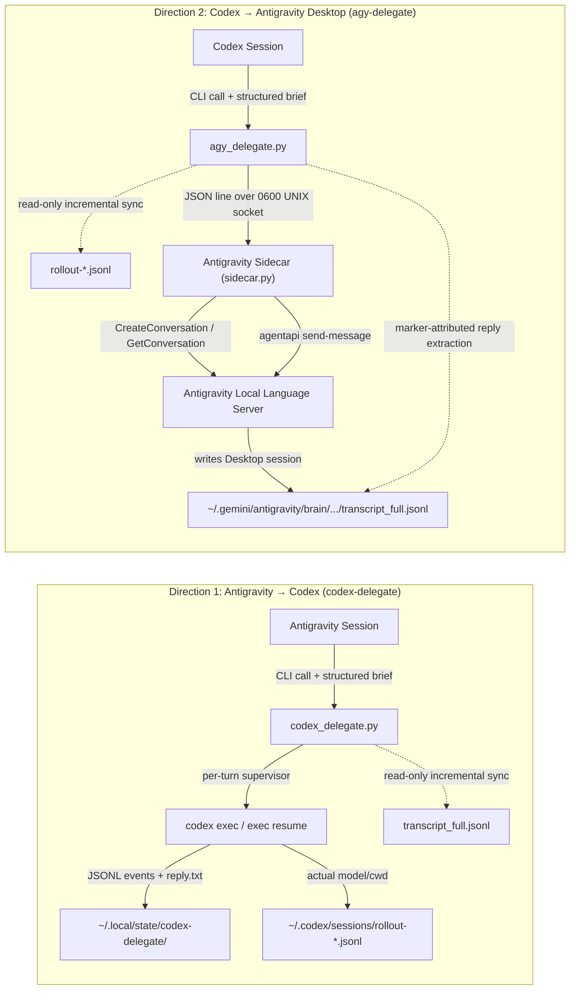
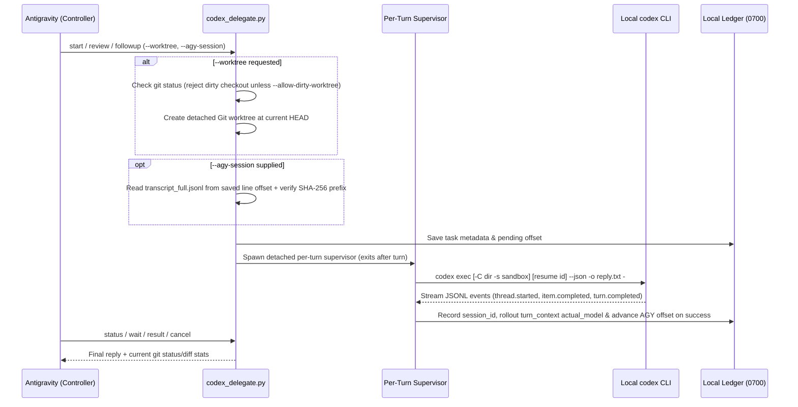
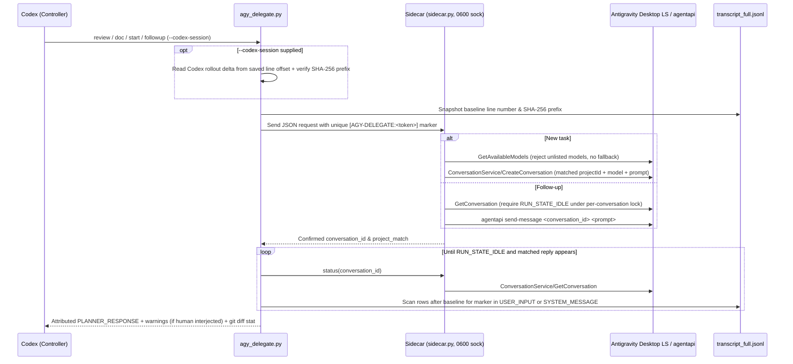

# codex-antigravity-delegate

Lightweight, zero-dependency **bidirectional supervised delegation** between **OpenAI Codex** and **Google Antigravity** — packaged as two portable agent skills and a minimal official Antigravity Desktop Sidecar.

Stay in your primary window, hand off implementation, code reviews, or document rewrites with structured context, follow up in the same session, and inspect the resulting diff before accepting — without switching windows, copy-pasting transcripts, running a heavy MCP relay, or wrapping `agy -p`.

---

## Why This Exists

Cross-model collaboration between Codex and Antigravity is **asymmetric** by design:

- **Antigravity → Codex** is straightforward: the local `codex` CLI natively supports non-interactive execution (`codex exec`), session continuation (`codex exec resume`), explicit model & reasoning effort flags, OS-level sandboxes (`read-only` / `workspace-write`), and Git worktree isolation.
- **Codex → Antigravity** has tighter boundaries: wrapping `agy -p` inside third-party coding agents is unsupported under Antigravity consumer plans, while heavy third-party MCP bridges couple tightly to private desktop internals.

This repository treats each direction with the lightest native mechanism that fits it:

1. **`codex-delegate` (Antigravity → Codex)** — Zero-daemon Python CLI wrapper around native `codex exec` / `codex exec resume`, with a per-turn temporary supervisor that exits as soon as the turn ends.
2. **`agy-delegate` (Codex → Antigravity Desktop)** — A minimal official Antigravity Desktop Sidecar (~300 lines of Python stdlib, `0600` local UNIX socket only) talking to Desktop's local `ConversationService` and `agentapi`, paired with a symmetric CLI skill for interactive reviews, document rewrites, and follow-ups.

Both components use **only the Python 3.9+ standard library**. No third-party packages, no TCP ports, no private Codex Desktop pipes, and no `agy -p` wrapping.

---

## What It Can Do

| Capability | `codex-delegate` (`Antigravity → Codex`) | `agy-delegate` (`Codex → Antigravity Desktop`) |
| --- | --- | --- |
| **Primary use cases** | Implementation, isolated bug fixes, read-only code review, multi-turn rework | Interactive code/design review, document rewriting, Desktop-visible follow-ups |
| **Zero window switching / copy-paste** | Yes | Yes (while Antigravity Desktop is running) |
| **Explicit model selection** | `--model` (full ID or `sol` / `astra`) + `--effort`; no silent fallback | `--model` (full ID or `neon` / `carbon` / `argon` / `flash`); validated against Desktop catalog, no silent fallback |
| **Read-only code review** | OS-enforced `read-only` sandbox (`--uncommitted`, `--base`, `--commit`) | Instruction-scoped review (`--uncommitted`, `--base`, `--commit`, or `--file`) |
| **Isolated Git worktree** | Built-in `--worktree` with dirty-checkout protection | Not used (shares workspace for reviews & doc edits) |
| **Same-session follow-up** | `followup` via `codex exec resume` (can override model/effort) | `followup` via `agentapi send-message` (keeps original session & model) |
| **Incremental conversation handoff** | `--agy-session <UUID>` with line offset + SHA-256 prefix check | `--codex-session <UUID>` with line offset + SHA-256 prefix check |
| **Background supervision** | `--background`, `status`, `wait`, `result`, `list` | `--background`, `status`, `wait`, `result`, `list` |
| **Cancellation** | `cancel` (`SIGTERM` → `SIGKILL` to process group) | Manual **Stop** in the visible Antigravity Desktop conversation |
| **Read-only session lookup** | `read-session` for both Codex `rollout-*.jsonl` and AGY `transcript_full.jsonl` | Reads local `transcript_full.jsonl` with marker attribution & interjection warnings |

---

## Repository Structure

```text
codex-antigravity-delegate/
├── install.sh                               # Idempotent installer & uninstaller
├── skills/
│   ├── codex-delegate/
│   │   ├── SKILL.md                         # Skill instructions for Antigravity → Codex
│   │   └── scripts/codex_delegate.py        # Native Codex CLI supervisor & session reader
│   └── agy-delegate/
│       ├── SKILL.md                         # Skill instructions for Codex → Antigravity Desktop
│       └── scripts/agy_delegate.py          # Sidecar client, ledger & transcript extractor
├── sidecar/
│   └── agy-delegate/
│       ├── sidecar.json                     # Official Antigravity Sidecar manifest template
│       └── sidecar.py                       # 0600 UNIX-socket bridge to ConversationService & agentapi
├── tests/
│   ├── test_codex_delegate.py               # Unit & stub integration tests for codex-delegate
│   ├── test_agy_delegate.py                 # Unit & stub integration tests for agy-delegate + Sidecar
│   └── test_install.py                      # Isolated HOME installer/uninstaller tests
└── .github/workflows/test.yml               # CI matrix (Ubuntu & macOS × Python 3.9 / 3.12)
```

---

## Installation

### Prerequisites

- **Python 3.9+** and **Git**
- For `codex-delegate`: an authenticated local **Codex CLI** (`codex` on `PATH`, ChatGPT Desktop embedded CLI on macOS, or NVM install)
- For `agy-delegate`: **Antigravity Desktop** installed and running (with Sidecars enabled, which is the default on current Desktop builds)

### Quick Install

```bash
git clone https://github.com/Al-assad/codex-antigravity-delegate.git
cd codex-antigravity-delegate
./install.sh
```

What `./install.sh` does:
1. Installs [`codex-delegate`](skills/codex-delegate/SKILL.md) and [`agy-delegate`](skills/agy-delegate/SKILL.md) into `${AGENTS_SKILLS_DIR:-$HOME/.agents/skills}/`.
2. Copies the official Sidecar into `${GEMINI_CONFIG_DIR:-$HOME/.gemini/config}/sidecars/agy-delegate/` and writes the active `python3` absolute path into the installed `sidecar.json` so Desktop can launch it even with a minimal `PATH`.
3. Atomically updates `${GEMINI_CONFIG_DIR:-$HOME/.gemini/config}/config.json` to enable `sidecars["agy-delegate"]`, preserving all existing settings, `projectId`, and other sidecars.
4. Refuses to overwrite or delete unmanaged or locally modified installs — back them up or move them aside first if you already have a custom copy.

### Installer Options

```bash
./install.sh --copy                # Copy skills (default; repo checkout not needed at runtime)
./install.sh --symlink             # Symlink skills to this checkout (Sidecar is still copied)
./install.sh --only codex          # Install only codex-delegate (no Sidecar)
./install.sh --only agy            # Install only agy-delegate + Sidecar
./install.sh --dry-run             # Preview planned changes without writing anything
./install.sh --uninstall           # Remove managed files and clean sidecars["agy-delegate"]
```

### Verify Installation

```bash
# 1. Check codex-delegate CLI
~/.agents/skills/codex-delegate/scripts/codex_delegate.py --help

# 2. Check agy-delegate Sidecar health (Antigravity Desktop must be running)
~/.agents/skills/agy-delegate/scripts/agy_delegate.py health --json
```

Expected health output when Antigravity Desktop has loaded the Sidecar:

```json
{
  "state": "ready",
  "pid": 12345,
  "has_ls_address": true,
  "has_csrf_token": true,
  "default_project_id": "..."
}
```

> If `health` reports the socket is missing right after installation, restart **Antigravity Desktop** once so it picks up the newly enabled Sidecar, then run `health` again.

---

## Usage Examples

### Inside Antigravity (`codex-delegate`)

Ask Antigravity directly in natural language:

- **Read-only code review of uncommitted edits:**
  > "Use `codex-delegate` with `gpt-6.2-sol` (high) to run a background read-only review of the uncommitted changes in this repo, focusing on race conditions and edge cases."
- **Isolated implementation in a Git worktree + follow-up:**
  > "Use `codex-delegate` to delegate fixing the pagination boundary to `sol` (high) in a separate `--worktree` and run the unit tests. Show me the diff before merging."
- **Read-only lookup of a prior Codex thread:**
  > "Use `codex-delegate read-session` to inspect the last 10 messages of `codex://threads/<UUID>`."

Direct CLI equivalents:

```bash
cdg="$HOME/.agents/skills/codex-delegate/scripts/codex_delegate.py"

# Start an isolated implementation task in the background
"$cdg" start --cwd /path/to/repo --model sol --effort high \
  --worktree --include-git --background --json-output \
  --prompt 'Fix the pagination boundary without changing the public API. Run the unit tests.'

# Review uncommitted changes (read-only sandbox, shared checkout)
"$cdg" review --cwd /path/to/repo --uncommitted --model sol --effort high \
  --prompt 'Check for race conditions and list findings with file and line numbers.' --background

# Supervise, inspect, follow up in the same Codex session, or cancel
"$cdg" status <task-id> --json-output
"$cdg" wait <task-id> --timeout 120 --json-output
"$cdg" result <task-id>
"$cdg" followup <task-id> --prompt 'Add a regression test for empty pages.' --background
"$cdg" cancel <task-id> --grace 3

# Read local Codex or Antigravity session logs without calling any model
"$cdg" read-session 'codex://threads/<UUID>' --tail 8
"$cdg" read-session '<agy-uuid>' --source agy --tail 8
```

### Inside Codex Desktop (`$agy-delegate`)

Invoke the skill explicitly with `$agy-delegate`:

- **Read-only review by Neon:**
  > "Use `$agy-delegate` to ask `neon` for a read-only review of my uncommitted changes here, focusing on regression risks."
- **Document rewrite by Carbon:**
  > "Use `$agy-delegate` to have `carbon` tighten `docs/architecture.md` while keeping every technical fact and open question intact."
- **Continue the same Desktop conversation:**
  > "Follow up on that `agy-delegate` task and ask it to shorten section 3 by half."

Direct CLI equivalents:

```bash
agy="$HOME/.agents/skills/agy-delegate/scripts/agy_delegate.py"

# Check Sidecar readiness
"$agy" health

# Ask Neon for a read-only review
"$agy" review --cwd /path/to/repo --uncommitted --model neon \
  --prompt 'Focus on regressions and edge cases.' --background

# Ask Carbon to rewrite a specific file
"$agy" doc --cwd /path/to/repo --file docs/plan.md --model carbon \
  --prompt 'Make this concise without changing facts or open questions.' --background

# Wait, inspect reply + git diff stat, and follow up in the same Desktop session
"$agy" wait <task-id> --timeout 120
"$agy" result <task-id>
"$agy" followup <task-id> --prompt 'Shorten section 3 and keep the checklist.'
```

---

## How It Works

### High-Level Architecture

The two directions share a common design philosophy — **structured briefs, local file ledgers, incremental checksummed log sync, and zero external dependencies** — while matching each tool's native boundary:



### Flow 1: `codex-delegate` (`Antigravity → Codex`)



Key engineering details:
- **Review adapter**: Local `codex exec review` cannot combine scope flags (`--uncommitted`, `--base`, `--commit`) with custom stdin prompts or `-C`/`-s`, so `codex-delegate` always uses `codex exec -s read-only` with an explicit verified Git scope.
- **Dirty-worktree guard**: A Git worktree created from `HEAD` never includes staged, unstaged, or untracked edits. `codex-delegate` rejects `--worktree` on a dirty repo unless `--allow-dirty-worktree` is explicitly passed, and always forbids `--worktree` for uncommitted reviews.
- **Process-group cancellation**: Each Codex turn runs in its own session (`start_new_session=True`), so `cancel` sends `SIGTERM` (and `SIGKILL` after `--grace`) to the entire process group, while truthfully reporting that file edits are not automatically rolled back.
- **No silent model fallback**: Actual executed model, effort, and working directory are read back from Codex's own `rollout-*.jsonl` `turn_context` records rather than guessed.

### Flow 2: `agy-delegate` (`Codex → Antigravity Desktop`)



Key engineering details:
- **Why both `USER_INPUT` and `SYSTEM_MESSAGE` are matched**: `ConversationService/CreateConversation` records the initial prompt as `type: "USER_INPUT"`, while `agentapi send-message` records follow-ups as `type: "SYSTEM_MESSAGE"` containing the delegated payload. Matching the unique `[AGY-DELEGATE:<token>]` marker across both ensures reliable turn attribution while ignoring unrelated system reminders.
- **Human interjection detection**: Because the conversation is live in Antigravity Desktop, you may jump in and type a message yourself. `agy_delegate.py` slices replies strictly between the delegated marker and any subsequent user turn, and emits a warning whenever extra user messages appear after the baseline.
- **Uncertain vs. rejected writes**: If a mutating RPC times out or drops mid-flight, the Sidecar marks the error `uncertain` and the ledger records `dispatch_unknown` without advancing the Codex offset — preventing blind duplicate resends.
- **Graceful offline fallback**: When Antigravity Desktop is closed, `agy_delegate.py` fails fast with a clear message and can print a compact manual handoff brief via `--fallback-brief`.

---

## Security, Privacy & Boundaries

- **Local-only IPC**: The Sidecar binds exclusively to a `0600` UNIX domain socket inside a `0700` user-owned directory, verifies ownership before connecting or unlinking, and restricts `ConversationService` RPCs strictly to loopback (`127.0.0.1` / `localhost` / `::1`).
- **Explicit context sharing**: Conversation history is **never** sent unless you explicitly pass `--agy-session` or `--codex-session`. Both helpers strip internal tool outputs/thinking blocks and treat transcript excerpts strictly as data.
- **No `agy -p` wrapping**: `agy-delegate` uses only Antigravity Desktop's official Sidecar runtime (`ConversationService` + `agentapi`) for interactive, low-frequency personal delegation — never unattended loops or headless `agy -p` wrapping.
- **Honest enforcement differences**:
  - `codex-delegate` enforces `read-only` / `workspace-write` at the Codex sandbox layer and supports process-group `cancel`.
  - `agy-delegate` relies on prompt-level scope boundaries (no OS-level read-only sandbox on Desktop sessions) and has no programmatic cancel API — click **Stop** in Antigravity Desktop if a run goes off-track.

---

## Configuration (Environment Variables)

| Variable | Applies To | Default | Purpose |
| --- | --- | --- | --- |
| `AGENTS_SKILLS_DIR` | `install.sh`, skills | `~/.agents/skills` | Shared skill install directory |
| `GEMINI_CONFIG_DIR` | `install.sh` | `~/.gemini/config` | Antigravity config & sidecars directory |
| `CODEX_DELEGATE_CODEX` | `codex-delegate` | Auto-discovered | Override path to `codex` binary |
| `CODEX_DELEGATE_STATE_DIR` | `codex-delegate` | `~/.local/state/codex-delegate` | Task ledger & logs directory (`0700`) |
| `CODEX_HOME` | Both | `~/.codex` | Codex configuration & `sessions/` root |
| `AGY_DELEGATE_STATE_DIR` | `agy-delegate` | `~/.local/state/agy-delegate` | Task ledger directory (`0700`) |
| `AGY_DELEGATE_SOCKET` | `agy-delegate` + Sidecar | `~/.local/state/agy-delegate/sidecar.sock` | Custom UNIX socket path (must match on both ends) |
| `AGY_DELEGATE_BRAIN_DIR` | `agy-delegate` | `~/.gemini/antigravity/brain` | Antigravity Desktop transcript root |
| `AGY_DELEGATE_PROJECTS_DIR` | Sidecar | `~/.gemini/config/projects` | Antigravity Desktop project registry root |

---

## Development & Testing

Run the full offline test suite (zero external dependencies, no network calls, no changes to your real `$HOME`):

```bash
python3 -m unittest discover -s tests -v
```

CI runs the full test suite on both **Ubuntu** and **macOS** across **Python 3.9** and **Python 3.12** via [`.github/workflows/test.yml`](.github/workflows/test.yml).

---

## License

[MIT](LICENSE)
